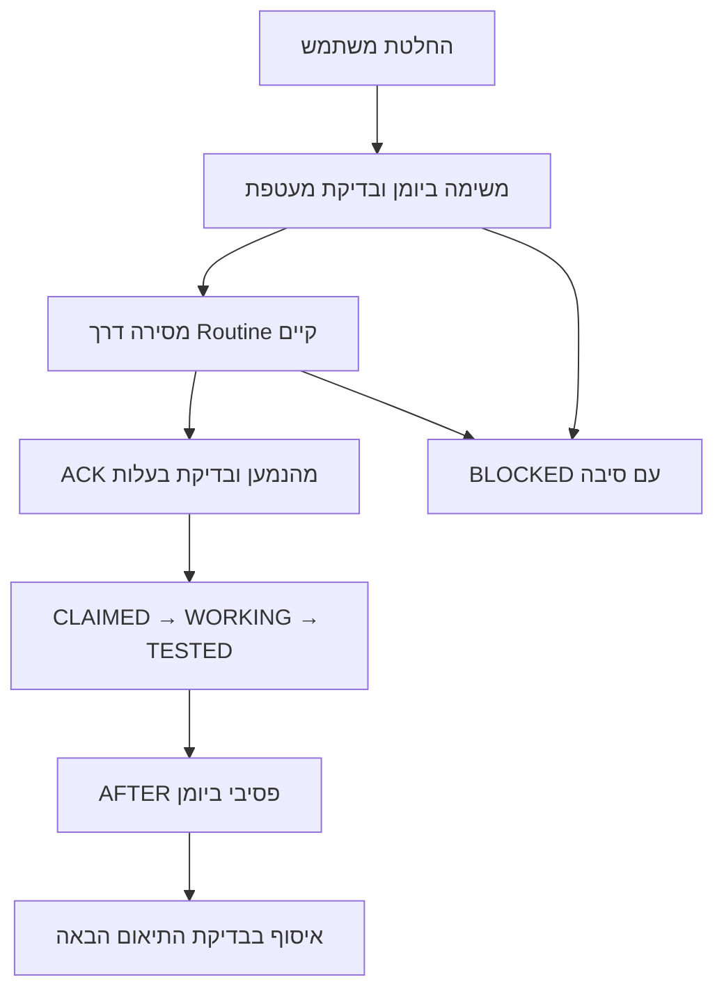

# Session coordination repair — branch evidence

Owner: existing `inter_agent_coordination_law` v16. Task `SESSION_COORDINATION_PREFLIGHT_ACK_REPAIR_20261014`.
Technical base: `5dd7032e1ba32af350c1179a543dde69400d146f`. No live migration, release, flag, research or content changes.

## Causes verified live

- `SYSTEMFRAME_ONE_SHELL_WORLD_HOME_20261014` (`379606a8`) was deferred by the emitter's branch-only release check.
- `G4_SOURCE_SEQUENCE_FRAME_ADOPTION_V1_20261013` (`01722689`) was deferred by its incomplete governance check.
- Both had empty `dispatch_context`. The sender and legacy INSERT adapter admit incomplete tasks; validation was only downstream in emit. The old claim path did not revalidate governance or require receiver ACK.
- Scope equality was the only writer conflict predicate; differently named tasks could overlap files. Existing unique scope and assignment indexes are retained.
- Recovery still produced Claude-to-GPT RESULT_WAKE on exhausted leases, contrary to the passive-result policy.
- A transport fire or created session does not prove reading. Some runtime results had explicit ACK only in separate evidence rows, not correlated receipt fields.

## Branch implementation

The CLI-generated migration extends existing functions and `work_log.dispatch_context`. No table, queue, dispatcher, cron, public access grant or new authority is introduced.
It adds preflight before outgoing transport and before claim, a structured overload of the existing sender, explicit receiver ACK, lease-bound lifecycle progress, file/directory overlap reservations, payload-sensitive idempotency, safe requeue and passive recovery results.
Unknown delivery timeouts block instead of spawning duplicate sessions. Expired WRITE leases retain reservation until explicit owner reconciliation. Invalid rows remain visible with a specific blocking reason; changing status alone cannot release them.
The recipient's Git observations and authorization reference are evidence assertions from a trusted runtime; SQL cannot inspect Git or prove a human's decision by itself. The receiver must verify them independently and stop all writes on lease expiry. Raw direct SQL is privileged administration, not a replacement for the canonical APIs.

## Acceptance evidence

`scripts/test-agent-dispatch-preflight-ack.mjs` executes actual proposed SQL in isolated PGlite with a stubbed HTTP transport and a disposable Git fixture. It covers invalid authorization, both reported failures, no fake ACK, real/idempotent receiver receipt, exact base/head, file and directory conflicts, actual fixture branch write, evidence before successful AFTER, sender timeout/retry, retained expired WRITE reservations, passive recovery, dependency gates, status-only bypass rejection, v16 direction and per-owner decision notifications. This is isolated-runtime evidence, not a live WRITE agent run.
The existing one-directional SQL suite and architecture contract are also run. CI receives the new executable SQL suite with a pinned PGlite runtime.

**Real existing-runtime probe:** assignment `63ca7fe8-48d5-40fb-802b-aaab2cead2d3`; receiver ACK `1db9b03d-ea5c-4746-b62e-60fb5bcda5e2` at `2026-10-14T00:29:27Z`; Claude session `session_01BfofxuYEXoPyi1gJoyQd77`. The receiver read the exact assignment, obtained the existing canonical claim and returned passive AFTER `d78b25e1-6c46-46c3-9f57-5562cc95da66`. Sender read these back from the live ledger. No user relay. At probe time the branch was not pushed, and the reviewer correctly disclosed that code review was not performed.

## Rollout limits

This PR is branch-only. Structured ACK enforcement is NOT live until an authorized migration/receiver rollout passes its gates. The existing GPT→Claude Routine works; direct addressing of arbitrary already-open GPT/Claude chat sessions is not exposed by this runtime. Do not claim all active chats were notified. GPT collects passive AFTERs on its next bounded coordination scan, not through unauthorized wake/polling.
Keep both original DEFERRED WRITE tasks blocked. Do not requeue them as part of this repair. An authorized operator must deploy the migration and compatible receiver instructions together; test a fresh READ_ONLY task, then an isolated approved WRITE fixture, before production infrastructure adoption. No product deployment is part of that rollout.
