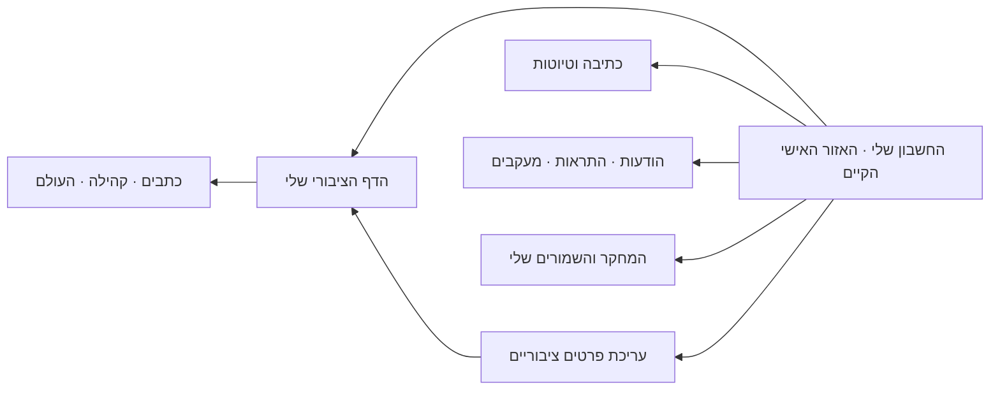

# Writer pages: Legacy parity, meaningful 3D identity and personal-area continuation

Actor GPT · task WRITER_PAGES_LEGACY_PARITY_REVIEW_20261023 · passive handoff to ZURIEL.
Branch `claude/2029-writer-legacy-parity-20261023`, base `a690a8233f451577ef8eeac9954c609c29834157`.
Required reader base `cfa786c1` remains an ancestor. Current remote main was checked at `e73687221aa2ab639930643e5cc8c99666adce88`.
BEFORE: `a3341bbb-1ba3-4e68-aa94-7c13007ae862`.

## Scope and evidence

This is a source-level parity review of the ten sections in current-main `src/pages/ContributorPage.jsx`, its rendered dependencies, Legacy `ProfilePage`/`userCenter/UserCenter`, the existing 2029 WorkspaceProjection, the new contributor page/catalogue/rank and the existing person-profile projector. It is not a claim that every conditional Legacy feature was exercised in a signed-in browser. The earlier hosted browser remains blocked by existing anti-bot policy; no policy was weakened.

Live dedicated read-only Supabase checks were bounded to schema, public-profile field presence/counts and existing function definitions. No private message bodies, account IDs, studio access codes or personal data were collected for this review. The general connector is used only for the authorized passive coordination BEFORE/AFTER, not product mutations.

Relevant existing owners: Writer Material Home v6 / Research Intake; Person Foundation v6; Subscription Funnel; Research Workspace v5; Truth Axes; shared Experience/Design V2/System Frame and canonical UI components. No new identity, graph, rank engine, studio, subscription store, inbox or personal area is proposed. This brief is technical/product advice; it does not start a second visual writer or grant release authority.

Live facts, 23 October 2026:

- Tzvi has no configured public contributor avatar. Keep the initial **צ** until a real public portrait is deliberately chosen; do not generate a face or publish the account/social photo automatically.
- Tzvi has an existing bio and a distinct `dossier_settings.about` (six characters); the new page consumes only bio. The short about value must not replace a useful introduction just to achieve field parity.
- Christina has **two public, non-personal `contributor_content` items**. The current new loader does not consume this source family. This is a real missing content family in the new Preview; no original row was deleted, and Legacy Production remains unchanged.
- Another sampled public automatic contributor also has one public studio item. Studio compatibility therefore cannot be a Christina-only exception.
- Sampled Tzvi/Christina profiles have no configured highlights, external links or section ordering. This does not prove those capabilities are absent for every writer.

## Feature matrix

| Legacy capability and evidence | Current new page | Disposition |
| --- | --- | --- |
| Name, role, avatar and bio — ContributorPage:918 | Implemented public fields | Keep; share an identity presentation with the personal area, with explicit public-photo choice. |
| About and current focus — DossierExtras:355/388; ContributorPage:874/1186 | Bio only | Add approved public about/focus through an allowlisted reader. Keep account/private context out. |
| Level/rank — RankCard; research_level_of | Implemented level/label and CSS 3D seal | Preserve the authority; give the seal identity/navigation meaning rather than another score. |
| XP and next-level progress — RankCard; UserCenter:405 | Deliberately absent publicly | Detailed progress belongs to self view; consume authoritative server floor/next_xp, including seniority behavior. Do not copy Legacy's client thresholds or minimum fabricated percent. |
| Follow writer — FollowWriter / WatchButton | Missing | Reuse subscription system. Legacy `author:<name>` topics need an identity adapter preserving existing follows; do not create duplicate name/slug subscriptions or infer identity. |
| Message writer — WriterMessage | Missing | Reuse authenticated DM/inbox, with exact recipient resolution. Distinguish private messages from public comments and team contact. No automatic new inbox. |
| Share / all-writers entry — ShareActions / researcher directory | Missing | Reuse the canonical share component and directory; validate canonical URL and OG behavior. |
| Public WhatsApp group link / owner connection — ContributorPage:942/1292 | Not connected | Only an explicitly public group URL may appear. Linking/configuration belongs in self view; no inferred phone/group publication. |
| Latest source publications / image gallery — channel_updates | Implemented for Tzvi: 20 recent, pagination, formats and exact World links | Keep paired media/text, source refs and structured-only topic categories. |
| Full authored posts / participation / tagged mentions — ContributorPage:657/732 | Partial: canonical contribution inputs only | Public native Post attribution seam needed. “Authored”, “participated” and “tagged/about” remain separate; no display-name/tag-based authorship inference. |
| Specialty center, verified gematria, ciphers, Findings, Topics, connections — ContributorPage:1024–1120 | World entry / canonical reader coverage, not full parity | Link to existing typed World/Number/ELS/Topic capabilities using proven attribution. Do not rebuild per-writer tools or a research repository in the gateway. |
| Archive search, category filters, load more, per-viewer hidden cards — ContributorPage:1124 | Formats/pagination exist; full text search and hidden-card preference do not | Search can filter the existing catalogue later without a new content store. Do not port regex-based semantic categories. Hiding is a personal preference, not source deletion. |
| Current focus and studio blocks — ContributorPage:1183, StudioBlocks:248, studio_list | Missing public studio family, including two Christina items | P0 before replacing all public Legacy writers. Preserve existing IDs, body/media, order and publication flags; extend the owned public projection, not a copied corpus or writer-specific special case. |
| Editorial selections — ContributorPage:796/1384 media.top_rank | Missing | Render only explicitly curated choices with native source identity. This is editorial selection, not strength or independent verification. |
| Events and public milestones — ContributorPage:1323; ResearchJournal | Missing | Optional public timeline from published event/source records only. Private active-day/AI/search history must not become public milestones. |
| Forum authored threads and page discussion — ContributorPage:1399; Discourse | Separate community section exists; native parent/message/reply routing and counters incomplete | Restore exact thread/message references and aggregate received likes/replies through the public community owner; distinguish authored replies and received replies. |
| Private research, owner controls, personal facts, moderation — ContributorPage:1179/1436 | Correctly excluded | Keep in authenticated self/admin surfaces. Do not expose them in a signed-in administrator's public-page read. |
| Personal profile/editor, messages, notifications, follows, research, credits — UserCenter; WorkspaceProjection:1168 | Existing 2029 Workspace delegates some modules to Legacy via /profile | Extend the existing personal area progressively. Do not build a second dashboard or silently lose current editing modules. |
| Automatic profile noindex — Legacy AUTO_PROFILE_RE / SEO effect | **Fixed locally in this change** | Check canonical contributor slug, even when the URL uses a numeric code. Curated-profile behavior remains unchanged. |
| Merged aliases, unlisted visibility, locked/building states and sparse-profile SEO | Not full Legacy parity | Verify and reconcile before broad replacement. Current new loader fails closed for unlisted/private; that is not the same UX as Legacy's unlisted/noindex link. Existing password/UI gates are not an excuse to weaken server access. |

### Stored configuration is not proof of working Legacy behavior

`UserCenter.PageEditor` stores section order/visibility, up to six external links, highlights, accent/emblem and bio via existing `update_my_page_config`. In current-main ContributorPage, `page_config.highlights` is read for an empty-state decision, but those entries are not rendered as a list; the visible selections come from `media.top_rank`. The renderer does not consume `page_config.sections` or `page_config.links` either. Preserve configured data, but do not describe these as proven working Legacy features. The approved shared palette remains authoritative; per-writer customization must not override contrast, theme or global navigation.

`personProfile2029Projection.js` is an existing pure public/self/admin candidate model with community/research tabs. No current source import/call site was found. It is not an approved public data reader or evidence that likes/counts are available; its absent-metric-to-zero normalization needs an availability contract before reuse here. Reconcile with this existing seam rather than opening a parallel identity system.

## Recommended 3D identity seal

Use one reusable **identity medallion**. Its meaning is “whose material is this, and what activity rank does the existing system assign?”

- **Front:** deliberately published avatar, or a neutral canonical-name initial; name and rank label remain legible HTML. Retain normal proportions of the image rather than warping a face around a cube.
- **Frame:** exactly five stage marks; illuminate the number returned by the existing rank reader. The frame is an activity-rank display, never truth verification, editorial approval or funding/entitlement status.
- **Back/detail:** a brief existing public description and native entries to writings, community and World. Replace the current rotation-only action with a meaningful “about / activity” disclosure. No invented totals, stars or graph connections on the other faces.
- **Motion:** shallow depth and a deliberate flip/tilt only; no perpetual spin. Reduced motion offers a static image and the same links. Keyboard and screen-reader reading order must not depend on 3D rotation; the essential name, rank and links remain accessible outside decorative geometry.
- **Sizes:** full card in the public writer header; compact same-identity card in “my page” inside the existing personal area. Do not add another global bar or change the shared header in this batch.
- **Missing rank:** keep the identity visible and state rank unavailable; no default rank or zero. **Missing photo:** show an initial, not a fabricated portrait.

Do not turn the medallion into a personal research graph, claim-strength visualization, live-presence indicator or arbitrary progress ring. Such meanings need their own existing governed inputs and cannot be inferred from likes, uploads or text.

## Connect to the existing personal area afterwards

The same person has distinct authorized projections, not two profiles to maintain:

1. Resolve the signed-in account's existing contributor binding on the authenticated side. Navigate “view my public page” to canonical contributor code/slug, preserving exact return. A public request never creates a contributor or widens visibility.
2. Reuse `update_my_page_config` for public introduction/configuration and `update_my_dossier` for their existing permitted settings. Retain receipts and read-back. Profile photo and public writer avatar are currently different fields: offer a deliberate “use this photo publicly” choice; do not silently copy account/social data into the public identity.
3. Keep editing, drafts, personal studio entries, private research and moderation inside self/admin modules. “View as a visitor” opens the actual anonymous public projection, not a client-hidden admin version.
4. Public “follow” subscribes through the existing funnel; updates arrive through existing notifications. Public “message” resolves to the existing private inbox when authorized. A fallback to the team's contact queue must be named honestly, not reported as successful delivery to the writer.
5. Use the same rank identity presentation in both places. Public view receives only existing allowlisted level/label. Self view may display existing authorized XP/components/next threshold. **Live function inspection:** `my_research_level()` updates cached profile values; it is not a read-only public reader and must never be called from the public seal. No rank formula is reconstructed in the client.
6. Keep credits, private activity, saved/research path and personal replies private. Received public likes/replies may be aggregates; a person's list of likes, follower IDs, inbox and search/AI history do not follow them into the public card.

## Implementation order and acceptance

1. **Preserve:** automatic-profile noindex (this change); public studio source compatibility and policy/alias audit before a full writer replacement. Existing Production remains Legacy while these gaps are open.
2. **Identity presentation:** visual-lane implementation of the avatar/rank medallion in the existing contributor components. Check curated/no-photo/missing-rank, 320/390/desktop, three themes, keyboard and reduced motion. Public identity remains anonymous even for admins.
3. **Public actions:** share/directory, stable follow identity, honest message destination, canonical authored/community references and approved selections. No dead or pretend working actions.
4. **Personal continuation:** wire the same identity card to the existing Workspace and current modules; no frame/provider/auth rewrite. Prove self/public isolation, view/edit/return/reload, expired-auth return and saved publication read-back.

This turn changes no visual geometry, avatar, source corpus, studio data, subscriptions, private messages, personal module, shared frame, DB product data or production routing. New work beyond the SEO guard remains a recommendation and bounded handoff, not a delivered capability.

## Validation of the implemented guard

The model marks generated `r-<hex>` identities noindex using the resolved canonical slug; the page forwards that decision to existing `applySeo`. PASS: three focused contributor/catalogue/rank test files (23 contained cases), including numeric-code URL resolution, curated identity and case-insensitive generated slugs. PASS: four browser loader cases covering curated/automatic profiles as guest and simulated administrator, eight anonymous data requests each and private-marker exclusion. Curated robots remain `index, follow`; automatic profiles receive `noindex, nofollow` through the existing SEO helper. PASS: `npm run build:2029` (existing warnings; 1.39s), public-language check and diff checks. Existing route, frame, Auth/providers, Legacy and canonical reader files remain byte-identical to the base. Evidence: adjacent `writer-legacy-parity-evidence-20261023/`.

Release state: local branch only. The existing hosted Preview still points to `a690a823`; neither this SEO correction nor the proposed identity redesign is claimed deployed. No push, merge, domain/Production change or live product write occurred in this pass.
