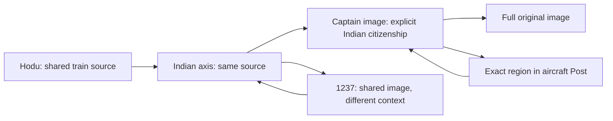

# Topic source connections — bounded release

This closes the missing India/aircraft connection and navigation between four pairs of existing Topics. It consumes the source package from PR #1015 (`95483de55e65f6fa1a09300dfa65ca733fbdcb4e`) on main `737ee9aa2df4aaa80dd95ea0fa3c4f2bcbc4f12a`. It does not release the unrelated Home integration in PR #1035.

Coordination: mapping `640695d8-e2ea-4504-91aa-c99f48079946`; ACK `aa629035-cb17-41db-94fe-ebdf5daa2d6a`; bounded main import `22b18d23-3dcd-4039-b15c-db69912dcb90`. The user explicitly authorized the main site after tests. Existing Source/Topic/Posts owners remain canonical; GPT integrates readers and existing presentation, with no new visual design. The 14 source CSS lines are the original source-package styles.

## What readers receive

| Connection | Exact basis | Meaning |
|---|---|---|
| `india-axis` ↔ aircraft Post 5112 | Public Post `flydubai-fz1073-363-14000-remzei-geula`, figure `smit-machchhar-source-20261001.jpg`, exact caption identifying the captain as an Indian citizen | Explicit source mention, rechecked on every read. Injury/rescue remains the screenshot's claim. No stored Topic tag or graph edge is invented. |
| `hodu` ↔ `india-axis` | Water-train image `8940efb2-8423-4a27-a10a-d3fdd07cf595`, second historical placement `4d0b8d36-0801-449b-a0a6-0c7ff543c5b0` | One image object, two preserved placements. Hodu reaches the captain through the Indian axis; it does not acquire an invented captain membership. |
| `india-axis` ↔ `1237` | `5579cca1-ff12-4a9a-87ee-e32e89ca9af3` | The same stored source in two documented contexts. |
| `trump` ↔ `424-mashiach-ben-david` | `00edc0d8-b792-45d9-aa86-d04b44600a3f` | Shared source, not proof of identical events. |
| `45-frequency` ↔ `meron` | `04ef63f1-a5ff-4867-8ae2-6bfc61921317`, `67a5c6d6-7830-4185-a77e-e947eb1fa1de` | Two image objects; repeated gallery appearances do not increase that count. |

The existing Entity Hub and Topic projections consume the same media envelopes. A bounded public-view query joins admitted image occurrence IDs to approved Topics. Numeric similarity never seeds the query. Related-link failure preserves the source section and reports unavailable link coverage. Source reading continues to enforce publication, minimum tier and curator-hidden gates.

Historical names, captions, credits and gallery order remain verbatim. Upload dates and folder-derived dates remain provenance, not verified event dates. No migrations, source edits, product tags, publication approvals or OCR runs are involved.

Exact example:

- Topic: `/topic/india-axis#topic-source-media-post-5112-source-region-smit-machchhar`
- Post: `/post/flydubai-fz1073-363-14000-remzei-geula#source-region-smit-machchhar`
- Full image: `https://linswmnnkjxvweumprav.supabase.co/storage/v1/object/public/gallery/sod1820/posts/fz1073/smit-machchhar-source-20261001.jpg`

Topic navigation records the exact origin source before leaving. Browser Back and reload restore that selection. Post heading restoration opens an existing collapsed source section before focusing its anchor. The Topic route now discards the previous route's result immediately, preventing stale canonical redirects during Topic-to-Topic navigation.

## Verification

- Pure source/privacy/identity/projection/Post-normalizer tests: `node --test src/lib/research/topicSourceContext.test.js test/topic-source-links.test.mjs test/post2029-connections.test.mjs`.
- Existing Topic acceptance, Universal Finding and 2029 isolation checks.
- Both legacy and 2029 production builds, with no integrated-preview flag.
- `scripts/test-topic-source-context-browser.mjs`: live anonymous data at 1440 and 390 pixels, full image, original captions, Post anchor, Back, reload, 1237 sequence. Both main-based and integrated trees passed.
- `scripts/test-topic-source-links-browser.mjs`: four shared-source pairs and Post reverse link; asserts exact selection after forward/back/reload and no horizontal overflow. Read-only test blocks application writes/telemetry; denied research-object reads are not promoted to public content.

Final commit, final browser results and deployment receipts are recorded in the release work_log AFTER, not inferred from this document. Browser evidence is in `/workspace/artifacts/topic-source-links` during this session.

## Separate remaining work

- The broader World discovery story and its integrated-preview Topic gate fix remain in the integrated lane. This release does not enable the Home/World preview flag or include its unrelated auth/Life/ELS/schema changes.
- Fourteen of the eighteen previously mapped gallery sources have no approved Topic membership. Their inclusion remains an editorial decision via existing Include/Publish; this patch does not retag them.
- The author's 14/45 and wisdom 7+3/3+7 bridge (gallery image `aa22e6ba-a18f-4d21-9388-93ec594aeb49`, gallery 69/order 4, Post 906) remains interpretation. No approved 73 Topic was found, and 7+3 is not asserted to equal 73.
- Gallery links preserve original collection identity and image selection in Context; the existing archive URL opens the gallery, not a certified exact-image deep link. This patch does not claim to repair that separate archive consumer.
- Original security PR #999 remains a separately governed migration release. No part of it is applied here.
